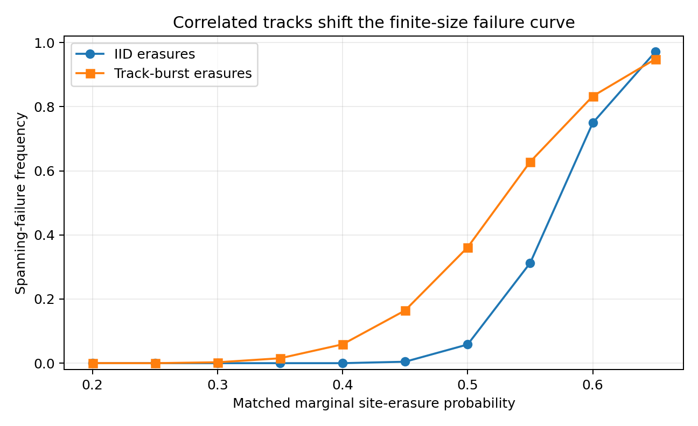

# Abstract
Reliability models often begin with independent errors, although ionizing radiation deposits energy in spatially correlated tracks. In superconducting devices, radiation-associated phonon bursts can transiently degrade multiple qubits; in cells, high-linear-energy-transfer (LET) particles produce clustered DNA lesions whose repair differs from that of isolated lesions. We formulate a substrate-agnostic description of burst damage as a marked spatial point process coupled to finite repair capacity. The framework separates geometric code correctability, damage-generation statistics, and repair-service stability. A queue-stability condition, λ E[S] < μ, gives a necessary workload criterion for stationary repair; a code-specific erasure criterion separately determines whether a burst footprint is reconstructable. A reproducible benchmark compares iid erasures with finite straight-track bursts on a 24 × 24 lattice at approximately matched marginal site-erasure probability. Across 4,000 Monte Carlo trials per point, track bursts yield a 5.875% spanning-failure frequency at marginal probability 0.40, versus zero observed iid spanning events; at 0.50, the rates are 36.15% and 5.825%. These are finite-size geometric-surrogate results, not logical-error rates of a physical code or measurements of biological damage. Holographic codes motivate recovery geometry, radiobiology supplies the track-structure motivation, and learned decoders suggest an inference strategy. The neutrino floor is treated only as a detector-background analogy, not as a biological mechanism.

# 1. Motivation and scope
A study published 19 October 2026 reports statistically significant reductions of up to 30.5% in both T1 and T2 immediately following dual detector events attributed to penetrating muons [1]. This is evidence of radiation-associated transient decoherence, not proof that one muon destroys an entire quantum computer. Earlier work also identifies spatially and temporally correlated errors in superconducting devices [2].

High-LET charged particles deposit energy densely along tracks. Their lesions can include clustered double-strand breaks (DSBs), nearby base damage and strand breaks, and chromosomal-scale consequences not captured by independent lesion counts [3–6]. The common abstraction is not that a cell is a quantum computer. It is that both are spatially extended information-bearing systems exposed to correlated disturbances and constrained recovery resources.

Contributions: a marked point-process model for burst footprints; separation of geometric correctability and repair-queue stability; an operational burst-risk functional; a reproducible finite-size benchmark; and a falsifiable cross-domain experimental programme.

# 2. Common mathematical language
Let G=(V,E) be a finite interaction graph with |V|=n. A damage event is marked by
\[
Z_k=(T_k,X_k,\Theta_k,L_k,W_k,M_k),
\]
where T is event time, X its anchor, Θ orientation, L extent, W width, and M severity or lesion-complexity mark. It generates footprint C(Z_k) ⊆ V and repair workload S(Z_k) ≥ 0. Events have mean rate λ; Poisson arrivals are a baseline, not a universal assumption. The damaged set is
\[
D(t)=\bigcup_{k:T_k\leq t<T_k+\tau_k}C(Z_k).
\]
A repair controller serves workload at total rate at most μ. Outstanding workload obeys
\[
Q(t+\Delta)\geq[Q(t)+A(t,t+\Delta)-\mu\Delta]_+.
\]
The burst profile is the joint law of footprint size, radius, aspect ratio, connected-component structure, and severity, not merely mean damaged-site count.

## Proposition 1 — Necessary queue-stability condition
For a stationary ergodic single-server fluid repair queue with workload arrival rate λ E[S] and constant service rate μ, a stationary workload distribution with finite mean requires
\[
\rho=\frac{\lambda\mathbb E[S]}{\mu}<1.
\]
**Proof.** Over an interval of length t, cumulative arriving workload divided by t converges to λ E[S]. Service removes at most μt. If mean input is at least service capacity, long-run net input is nonnegative; in the non-degenerate single-server setting a finite-mean stationary workload cannot be maintained. This is necessary, not sufficient for every correlated-arrival or priority model.

# 3. Correctability is not repair
For a quantum code with code projector P and erased subsystem R, exact erasure correction is governed by the Knill–Laflamme condition. In the full-code case, one form is
\[
P O_R P=c(O_R)P
\quad\text{for all operators }O_R\text{ supported on }R.
\]
Holographic codes add geometric structure: bulk operators may be reconstructed from boundary regions whose entanglement wedges contain the relevant bulk support [7–10]. This does not imply that arbitrary radiation tracks are always correctable.

No equivalent exact quantum-code condition is assumed for cells. A biological footprint is mapped to a pathway-dependent workload, residual lesion burden, and functional endpoint:
\[
\Phi(C,M;\eta)=\Pr\{\text{residual burden}>\eta\mid C,M,\text{substrate}\}.
\]
Quantum decoding, DNA repair, and cellular survival use different Φ functions and observables.

Let F be the family of footprints that are uncorrectable or functionally catastrophic under a specified substrate rule, and q_F = Pr{C(Z) ∈ F}. For Poisson event arrivals, thinning gives the exact horizon risk
\[
P_{\rm cat}(T)=1-\exp[-\lambda q_F T]. \tag{1}
\]
This excludes cumulative sub-catastrophic workload, overlap, repair during the horizon, and non-Poisson clustering. The operational safe region is
\[
\mathcal S=\{(\mathsf B,\lambda,\mu,\mathcal C):
\rho<1,\ P_{\rm cat}(T)\leq\epsilon,\
\Pr(Q(t)>q_{\max})\leq\delta\}. \tag{2}
\]
There is no universal scalar threshold independent of geometry, burst law, repair capacity, horizon, and tolerated risk.

# 4. Holographic recovery and quantum hardware
Holographic quantum error-correcting codes encode bulk degrees of freedom nonlocally across boundary degrees of freedom. Entanglement-wedge reconstruction explains why a bulk operator may remain recoverable after erasure of some boundary subregions, provided the surviving region retains the relevant wedge [7,8]. Code distance, geometry, and erasure location remain decisive; holographic structure is not automatic protection against every burst.

We propose to evaluate a specified code family under
\[
\mathcal N_{\rm burst}(\rho)=
\sum_z p(z)\operatorname{Tr}_{C(z)}(\rho)\otimes\sigma_{C(z)}
\]
and report logical failure over the full burst-profile distribution, not only an iid-erasure threshold. A hardware experiment should compare matched-rate iid and event-conditioned correlated channels using the same code, decoder, cycle budget, and logical observable.

# 5. Track-structured biological damage
High-LET heavy ions produce dense ionization patterns and complex DNA damage. Reviews describe clustered DSBs and non-DSB oxidative clustered lesions, with repair kinetics and pathway choice depending on lesion complexity and radiation quality [3–6]. Recent track-structure simulations across H–Fe ions quantify changes in cluster multiplicity with LET and ion species [11]. These findings motivate spatial models; they do not establish that every track overwhelms repair.

The dCas9–KillerRed system offers a controllable method to generate localized ROS-associated DNA damage at targeted genomic regions. Its foundational study reports rapid light-triggered clustered oxidative damage and rapid repair under the tested conditions, with low observed mutagenesis in that setting [12]. It is a calibration and perturbation platform, not proof of a heavy-ion-equivalent track or a general repair-overload phenotype. Candidate measurements include DSB-cluster imaging, repair-factor recruitment time courses, sequencing of repair outcomes, chromosome aberrations, and clonogenic survival. These endpoints must not be conflated.

# 6. Neural decoding and adaptive repair allocation
AlphaQubit 2 demonstrates high-accuracy, real-time neural decoding for topological codes under the noise settings studied [13]. This motivates training and testing decoders on measured correlated burst channels, but does not establish that AlphaQubit 2 has already been validated on the particular radiation-burst distribution proposed here. Held-out device runs and distribution-shift tests are essential.

A biological repair controller could allocate finite pathway capacity by solving
\[
\min_\pi \mathbb E_\pi\left[\sum_{t=0}^{H}c(x_t,u_t)+
\gamma\ell(x_H)\right],\qquad \sum_j u_{j,t}\leq\mu.
\]
This is a proposed control problem, not a demonstrated intervention. Observability, feasible actions, safety constraints, and reward validity must be established before reinforcement learning is used.

# 7. Synthetic benchmark
We implement a finite-size geometric surrogate on a 24 × 24 square lattice. Failure is a 4-neighbour connected erased component spanning horizontally or vertically. In the iid channel, each site is erased independently with probability p. In the burst channel, a Poisson number of finite five-site line tracks are placed with horizontal, vertical, and diagonal orientations; intensity is chosen to approximately match the same marginal site-erasure probability. Each point uses 4,000 trials and fixed seed 20261106.

| p | iid failures | track failures | Difference |
|---:|---:|---:|---:|
| 0.30 | 0/4000 | 11/4000 | 0.275 pp |
| 0.35 | 0/4000 | 61/4000 | 1.525 pp |
| 0.40 | 0/4000 | 235/4000 | 5.875 pp |
| 0.45 | 18/4000 | 658/4000 | 16.000 pp |
| 0.50 | 233/4000 | 1446/4000 | 30.325 pp |
| 0.55 | 1251/4000 | 2513/4000 | 31.525 pp |
| 0.60 | 2998/4000 | 3331/4000 | 8.325 pp |

At p = 0.40, zero iid events in 4,000 trials does not mean zero probability; the rule-of-three gives an approximate 95% upper bound of 3/4000 = 0.075%. The burst frequency is 5.875%. At p = 0.50, estimates are 5.825% and 36.15%. The curves approach one another at high density; the track channel is not uniformly worse at every point.

The benchmark shows that spatial correlation changes a geometric connectivity statistic at approximately matched marginal occupancy. It does not simulate a surface-code syndrome, holographic tensor network, quantum coherence, DNA chemistry, chromatin, or repair enzyme. Its values must not be called a quantum erasure threshold or cellular damage threshold.

# 8. Quantum biology and the neutrino boundary
Engineered fluorescent proteins have demonstrated optically detected magnetic resonance in living bacterial cells at room temperature, providing a biological quantum-sensing platform [14]. This is a quantum sensor based on spin-dependent photophysics; it does not make a cell a fault-tolerant quantum computer, nor does it demonstrate proton tunnelling as a cause of organism-wide mutation.

The “neutrino floor” has a precise meaning in dark-matter direct detection: coherent elastic neutrino–nucleus scattering creates a difficult-to-disentangle background for certain searches [15,16]. It is not a biological repair floor. Solar neutrinos are not proposed as a meaningful cellular damage source. The phrase in the title is an analogy for an inference limit in a separate detector domain, not a physical mechanism.

# 9. Limitations and falsifiable programme
This is a theory-plus-synthetic-benchmark preprint. It does not establish a universal burst-erasure law, a new holographic code, a biological repair mechanism, or measured improvements in quantum or cellular survival. The lattice generator should be replaced by calibrated event distributions. A holographic-code study needs a specified code, erasure channel, decoder, and finite-size scaling. A biological study needs radiation-quality-specific track data and preregistered repair and survival endpoints.

1. **Quantum:** collect event-conditioned qubit error maps; fit spatial-temporal burst kernels; compare surface, colour, and holographic codes at matched marginal rates and equal decoding latency.
2. **Radiobiology:** fit track kernels from transport simulations and microscopy; calibrate workload marks against lesion complexity; compare matched-total-dose burst and dispersed exposures.
3. **Repair control:** measure pathway-specific service distributions and test queue predictions before learning a repair policy.
4. **Cross-domain:** compare dimensionless burst-size/code-distance, workload/capacity, and persistence/recovery-time ratios, not biological and quantum observables as if identical.

# 10. Conclusion
A common mathematical language can describe spatial bursts, recoverability, and finite repair without asserting a common microscopic mechanism. Average error rate alone is insufficient: burst profile and recovery capacity must be measured jointly. Holographic codes offer a geometric vocabulary for quantum reconstruction; radiation track structure motivates clustered biological damage; queueing theory supplies a workload constraint; and learned decoders offer an inference strategy. The synthetic benchmark is a deliberately limited proof of concept. The defensible contribution is a testable framework and experimental agenda, not the claim that one muon defeats every quantum computer or one heavy ion necessarily defeats every cell.

## Reproducibility statement
All numerical values are generated from the included deterministic synthetic model. No human, animal, patient, or proprietary quantum-hardware data were used. A passing code check is not empirical validation or peer review.

## References
1. A. R. Castelli et al., “Superconducting-qubit decoherence correlated with detected radiation events,” *Physical Review Applied* 26, 044052 (2026), DOI: 10.1103/ddyy-t37l.
2. H. Binney et al., “Distinguishing types of correlated errors in superconducting qubits,” *Physical Review Applied* 26, 024025 (2026), DOI: 10.1103/j235-47t6.
3. Y. Hagiwara, T. Oike, and A. Niimi, “Clustered DNA double-strand break formation and the repair pathway following heavy-ion irradiation,” *Journal of Radiation Research* 60, 69–79 (2019), DOI: 10.1093/jrr/rry096.
4. A. Shibata, “Carbon ion radiation and clustered DNA double-strand breaks,” *The Enzymes* 51, 117–130 (2022), DOI: 10.1016/bs.enz.2022.08.008.
5. D. T. Goodhead and M. Weinfeld, “Clustered DNA Damage and its Complexity: Tracking the History,” *Radiation Research* 202, 385–407 (2024), DOI: 10.1667/RADE-24-00017.1.
6. B. Wilkinson, M. A. Hill, and J. L. Parsons, “The Cellular Response to Complex DNA Damage Induced by Ionising Radiation,” *International Journal of Molecular Sciences* 24, 4920 (2023), DOI: 10.3390/ijms24054920.
7. F. Pastawski, B. Yoshida, D. Harlow, and J. Preskill, “Holographic quantum error-correcting codes: Toy models for the bulk/boundary correspondence,” *JHEP* 06, 149 (2015), DOI: 10.1007/JHEP06(2015)149.
8. D. Harlow, “The Ryu–Takayanagi Formula from Quantum Error Correction,” *Communications in Mathematical Physics* 354, 865–912 (2017), DOI: 10.1007/s00220-017-2904-z.
9. R. J. Harris et al., “Calderbank-Shor-Steane holographic quantum error-correcting codes,” *Physical Review A* 98, 052301 (2018), DOI: 10.1103/PhysRevA.98.052301.
10. N. Bao, C. Cao, and G. Zhu, “Deconfinement and error thresholds in holography,” *Physical Review D* 106, 046009 (2022), DOI: 10.1103/PhysRevD.106.046009.
11. “Comprehensive database of track-structure simulations on DNA damage by H–Fe ions up to 1 GeV/u for space radiation biology,” *Scientific Reports* (2026), DOI: 10.1038/s41598-026-55264-8.
12. J. Wang et al., “Site-specific targeting of a light activated dCas9-KillerRed fusion protein generates transient, localized regions of oxidative DNA damage,” *PLOS ONE* 15, e0237759 (2020), DOI: 10.1371/journal.pone.0237759.
13. A. W. Senior et al., “A scalable and real-time neural decoder for topological quantum codes,” arXiv:2512.07737 (2025).
14. G. Abrahams et al., “Quantum spin resonance in engineered proteins for multimodal sensing,” *Nature* (2026).
15. E. Aprile et al. (XENON Collaboration), “Probing the Solar 8B Neutrino Fog with XENONnT,” *Physical Review Letters* 137, 091807 (2026), DOI: 10.1103/xvpn-w3q9.
16. Z. Tabrizi et al., “Clarity through the neutrino fog: constraining new forces in dark matter detectors,” *JHEP* (2025), DOI: 10.1007/JHEP08(2025)043.

<!-- reproducibility pipeline trigger: source audit complete -->
